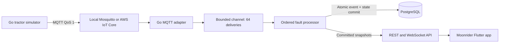
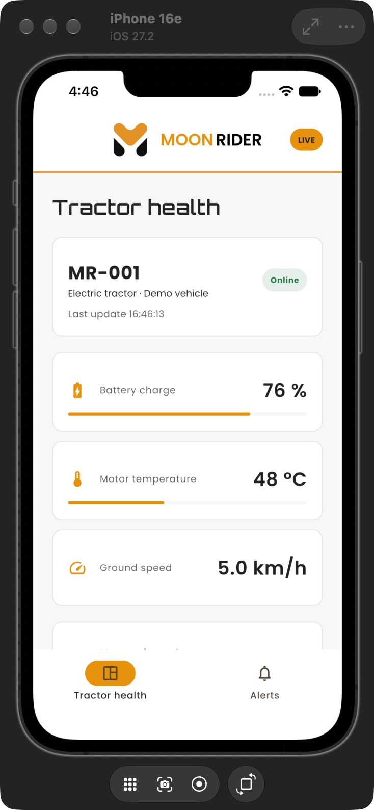

# Moonrider

A minimal electric tractor health-monitoring prototype: Flutter, Go, MQTT, PostgreSQL, and an AWS IoT Core integration. One simulated tractor, two screens, and a repeatable fault-and-recovery demo.

This is an independent portfolio prototype using synthetic readings, not an official Moonrider product or a vehicle safety system. Thresholds are illustrative. No real tractor connection or remote control.

## Start here

**Learning the code?** Read the short [code walkthrough](docs/CODE_WALKTHROUGH.md) first. It gives the reading order, data flow, and a short interview explanation.


| Goal | Guide |
| --- | --- |
| Explain the design and scaling path | [Architecture](docs/ARCHITECTURE.md) |
| Set up the required AWS resources | [AWS checklist](docs/AWS_SETUP.md) |
| Pitch the project and run a 90-second demo | [Pitch and demo](docs/PITCH.md) |
| Understand endpoints, payloads, configuration, and tests | [Development](docs/DEVELOPMENT.md) |
| See exactly what was verified | [Validation record](docs/VALIDATION.md) |
| Review official website colors, fonts, and asset sources | [Branding](docs/BRANDING.md) |
| Run on the installed iPhone simulator | [iOS setup](docs/IOS_RUN.md) |

## Quick demo: no AWS account or Docker needed

Requirements: Go 1.27.3+ and Flutter 3.47.9+ (Dart 3.13.7+), matching the installed toolchains used to build this project.

Terminal 1, from the project root:

```sh
cd backend
go run ./cmd/api --demo
```

Terminal 2, from the project root:

```sh
flutter pub get
flutter run -d chrome --web-port 5173
```

The backend cycles through normal operation, sustained overheating, cooling, low battery, and a 15-second silent uplink before resuming with a duplicate reading. The cycle repeats every 80 seconds. This mode uses in-memory storage and directly feeds the processor: **it bypasses MQTT, PostgreSQL, and AWS**. Use the full pipeline below to demonstrate those.

For an iOS simulator: `flutter run -d <device-id>` (API defaults to `127.0.0.1:8080`). Android emulator: `flutter run --dart-define=API_BASE_URL=http://10.0.2.2:8080`. Mobile local HTTP is for debug builds; use HTTPS/WSS for a deployed backend.

## Full local pipeline

Requires Docker with Compose. In separate terminals:

```sh
# Project root: broker, database, and containerized backend.
docker compose up --build
```

```sh
# Project root: simulator publishes QoS 1 telemetry to the local broker.
cd backend
go run ./cmd/simulator --scenario cycle --duplicate
```

```sh
# Project root: start the app.
flutter run -d chrome --web-port 5173
```

Do not run the demo backend and the container backend simultaneously on port 8080. Stop the demo first. To run Go outside Docker, use `docker compose up -d postgres mqtt`, source `.env`, and follow [Development](docs/DEVELOPMENT.md).

## Architecture at a glance



## Screenshots

Captured from the simplified Flutter app running on the iPhone 16e simulator, connected to the Go demo backend.



## Implemented

- Health screen: battery, motor temperature, speed, freshness, and tractor connectivity.
- Alerts screen: active and resolved episodes for low battery, overheating, and silence.
- Go modules with application-owned storage interface, injected dependencies, context cancellation, structured logs, and readiness checks.
- MQTT certificate/TLS configuration, reconnection, persistent broker session, bounded queue, and ACK after successful processing/persistence.
- Atomic PostgreSQL deduplication and persisted state; old/stale events cannot rewind live health.
- Riverpod, Dio, cross-platform WebSockets, REST recovery, heartbeat timeout, and capped reconnect backoff.
- Docker configuration, CI workflow, fault tests, API/WebSocket tests, a real-broker integration test, and optional PostgreSQL integration test.

## Deliberately deferred

Kafka, Flink, Redis, Firebase, RDS deployment, multi-tractor support, authentication, Kubernetes, and Terraform are **not implemented**. The job description names several of these; the [architecture guide](docs/ARCHITECTURE.md) explains their purpose in the next iteration. The current application has explicit seams for growth but is not a horizontally scalable production fleet platform.

## Quality checks

```sh
flutter analyze
flutter test
flutter build web
cd backend
go vet ./...
go test -race -cover ./...
```

The PostgreSQL integration test runs when `TEST_DATABASE_URL` is set and otherwise reports a skip. CI supplies PostgreSQL. The AWS integration requires your own certificates and endpoint; local tests do not prove AWS connectivity.
