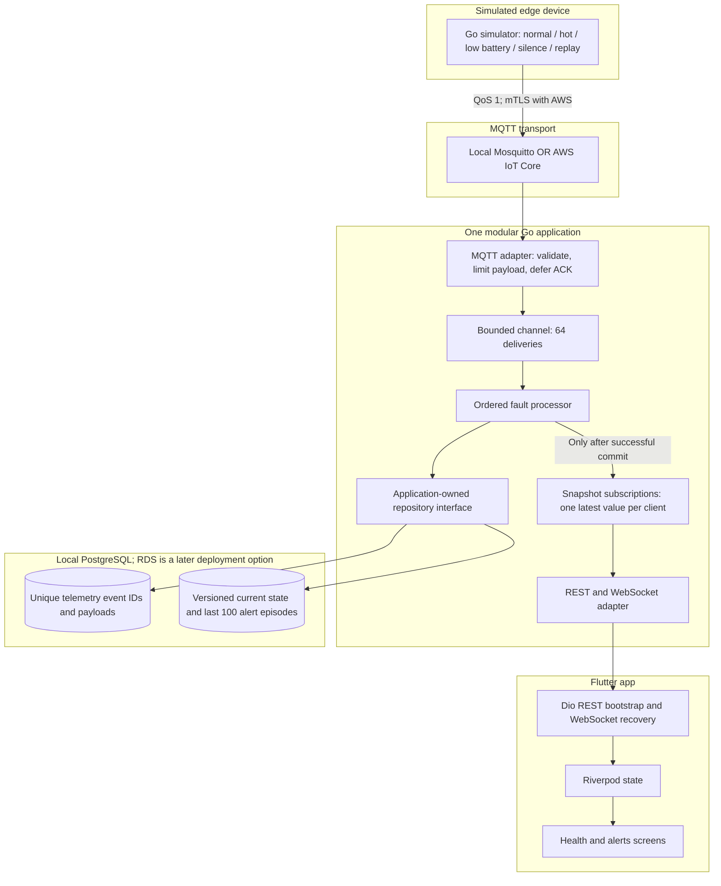
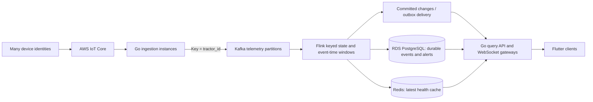

# Architecture and engineering decisions

## Scope and ownership

Moonrider implements a vertical slice of an electric-tractor telemetry platform: a synthetic device, reliable event ingestion, deterministic fault detection, durable state, and a live cross-platform app. The operational goal is to make loss of visibility and abnormal readings apparent to an operator.

The current deployment is **one tractor, one backend process, and one ordered processor**. It is designed with boundaries that support a later fleet implementation. It has not been load-tested or demonstrated at fleet scale. Do not run multiple backend writers against this schema: the singleton snapshot and in-process coordination do not implement distributed ownership.

## Current component diagram



The `--demo` path substitutes an in-memory repository and directly supplies synthetic deliveries to the same processor. It does not exercise MQTT or a database. The normal path has no fake data fallback: failed startup dependencies produce an error rather than silently switching modes.

## Dependencies and code structure

| Layer | Files | Responsibility |
| --- | --- | --- |
| Domain | `backend/internal/domain` | Telemetry, snapshots, alerts, supported sensor ranges |
| Application | `backend/internal/engine` | Ordered processing, fault transitions, offline checks; owns the repository port |
| Infrastructure | `backend/internal/store`, `mqttclient`, `httpapi` | PostgreSQL/memory adapters, MQTT, HTTP/WebSocket |
| Composition | `backend/cmd/api` | Dependency wiring, configuration, lifecycle |
| Simulator | `backend/cmd/simulator`, `internal/simulator` | Deterministic scenarios with synthetic sensor variation |
| App transport | `lib/data` | Typed payloads, REST bootstrap, live stream, retry and disposal |
| App state | `lib/state` | Riverpod lifecycle and dependency wiring |
| App presentation | `lib/ui` | User-facing health, alerts, and connection states |

The fault processor imports domain types and consumes an injected repository interface. It does not import the PostgreSQL adapter or MQTT library. Tests substitute memory and failing repositories. This demonstrates separation of concerns and dependency inversion without interface-per-function boilerplate or premature microservices.

## Delivery and consistency

```mermaid
sequenceDiagram
    participant S as Simulator
    participant B as MQTT broker
    participant M as Go MQTT adapter
    participant E as Ordered processor
    participant DB as PostgreSQL
    participant F as Flutter
    S->>B: QoS 1 event
    B-->>S: Publisher PUBACK
    Note over S,B: Broker acceptance is not a database commit
    B->>M: Telemetry delivery
    M->>E: Validated event via bounded channel
    E->>DB: BEGIN; insert unique event; save resulting snapshot
    DB-->>E: COMMIT
    E-->>M: ACK callback after processing
    M-->>B: Subscriber PUBACK
    E->>F: Committed snapshot over WebSocket
    Note over E,DB: Duplicate ID: no state write or new fault episode
```

The system uses **at-least-once delivery plus idempotent processing**, not end-to-end exactly-once delivery. Invalid/oversized packets are acknowledged and rejected with logs so they cannot poison the queue. State persistence failures are retried without acknowledging the delivery. Persistent MQTT sessions and reconnect subscriptions help recover transient outages, subject to broker retention limits.

Old timestamps, equal timestamps, and samples older than the offline interval are intentionally ignored by the live processor and then acknowledged. They do not enter telemetry history. This MVP prioritizes fresh health over historical backfill. If database recovery takes longer than that freshness window, an uncommitted reading can age out. A future durable ingestion log must store raw events before applying a separate live-state freshness policy if complete history is required.

The simulator does not implement a durable device outbox. A publisher timeout is logged and later readings continue; this is not a lossless edge gateway. Its silence scenario pauses application telemetry while the MQTT connection can remain open. The offline rule detects missing **fresh telemetry**, not TCP connection state.

## Fault state machines

| Fault | Open | Resolve | Why |
| --- | --- | --- | --- |
| Motor overheating | Above 80°C for at least 5 seconds of continuing samples | Below 75°C for at least 5 seconds | Sustained windows plus hysteresis reduce chatter |
| Low battery | Below 20% | Above 25% | Hysteresis prevents repeated low-battery episodes near the boundary |
| Lost connectivity | No fresh received telemetry for at least 10 seconds | A new, fresh sample arrives | Broker replays cannot mark a silent tractor online |

Rules are configured in one function, `domain.DefaultRules()`, to keep the MVP easy to read. A telemetry gap at or beyond the offline window resets pending temperature windows. The engine persists active episodes and pending window timestamps. It preserves active alerts while trimming old resolved episodes to a maximum snapshot history of 100. This is a bounded demo history, not an audit archive. Database and host clocks must be synchronized; the simulator uses timestamps plus unique event IDs, and sequence numbers are informational within each simulator session.

## Concurrency, resource bounds, and recovery

- MQTT ingestion and the processor run independently. A 64-delivery queue and an ordered callback apply backpressure instead of spawning a goroutine per event. Paho's ordered callbacks do not perform blocking client API operations. Multiple concurrent processors for the same tractor would risk races in fault transitions, so they are not used.
- A mutex protects the engine snapshot, and persistence occurs before the new state is visible. Storage access has deadlines. This simple consistency model serializes this tractor's writes and reads; database latency therefore limits throughput.
- Each WebSocket subscription holds at most one pending full snapshot. A slow client loses intermediate snapshots but receives the latest complete state. Writes have deadlines; pings/read deadlines reap disconnected clients. Subscription buffers are bounded; the number of clients still needs admission/rate limits before public use.
- Flutter distinguishes phone-to-backend connectivity from backend-observed tractor freshness. It retains explicitly stale readings, detects a silent WebSocket after 15 seconds, reconnects with 1/2/4/8-second capped backoff, bootstraps with REST, and accepts the socket's initial snapshot. The ordered WebSocket stream replaces the current snapshot directly, so a restarted demo backend may safely reset its version.
- Signals cancel workers. HTTP has header/read/idle timeouts. JSON logs expose rejected packets, failed persistence, subscription failures, and request latency. `/readyz` checks database and MQTT subscription; `/healthz` checks process availability. Aggregate metrics and dashboards remain a next step.

## Security boundary

AWS uses TLS certificate verification and separate simulator/backend certificates with narrowly scoped IoT policies. Keys never belong in Flutter or Git. The API is a local demo without user authentication and binds to loopback by default. CORS and WebSocket origin checks limit approved browser origins; they do **not** replace authentication. Native clients have no browser origin constraint.

Android cleartext HTTP is permitted only in debug configuration for the local demo. iOS local networking permission is for development against a LAN backend. A public deployment needs HTTPS/WSS, user and tenant authorization, request and connection limits, protected secrets, and certificate lifecycle management.

## Path to fleet scale: proposed, not implemented



1. **Add a real tractor identity model.** Replace the hard-coded ID and singleton state with tenant-scoped per-tractor rows and authorization. Include device boot/session ID and monotonic sequence semantics.
2. **Separate durable ingestion from health projection.** Append validated raw events to Kafka before acknowledging subscriber delivery; configure producer durability and broker retention. Partition by tractor ID to preserve per-tractor ordering while parallelizing independent tractors. Define a dead-letter flow for malformed events.
3. **Move time windows to Flink when needed.** Use keyed state, event-time watermarks, late-data handling, checkpoints, and a defined replay/backfill policy. Flink sinks must support idempotent writes or coordinated transactions; enabling checkpoints alone does not make every external side effect exactly-once.
4. **Normalize and partition persistence.** Use PostgreSQL/RDS tables for per-tractor state and alert episodes; partition telemetry by time, enforce retention, and size connection pools per instance. Add durable alert history and migrations. Keep Redis as a replaceable cache, not the system of record.
5. **Scale queries and fanout separately.** Read replicas/cache serve queries; an outbox/committed change stream broadcasts updates to authenticated WebSocket gateways. Gateways need explicit device-to-client routing; a shared MQTT client ID is not a scaling strategy.
6. **Operate and measure it.** Add infrastructure as code, secrets management, multi-AZ database recovery, connection/queue/lag metrics, structured traces, alerts, and controlled load tests. Measure peak ingest rate, p95 commit-to-screen latency, queue fill, consumer lag, dedup counts, and reconnect recovery before making capacity claims.

The deliberate tradeoff is to demonstrate the core correctness properties with a small executable system, then explain where distributed ownership, replay, time semantics, and fanout require different machinery. Kafka, Flink, Redis, RDS hosting, and multi-instance behavior are not claimed as existing functionality.
