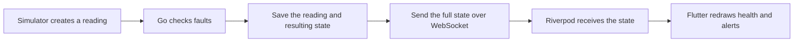

# Understand Moonrider in one sitting

Start with the running `--demo` app. That path uses five main files. The MQTT and database adapters are the second reading pass.

## The complete story

The app displays data. The Go backend owns the health decisions. There is one simulated tractor and one ordered processor.

## Read these files in order

| Step | File | Look for |
| --- | --- | --- |
| 1 | [`backend/internal/simulator/simulator.go`](../backend/internal/simulator/simulator.go) | `Next` creates a reading; `Cycle` picks a scenario; `Run` sends readings every second. |
| 2 | [`backend/internal/engine/engine.go`](../backend/internal/engine/engine.go) | `Process` validates and checks a reading; `CheckOffline` detects silence; `commit` saves before broadcasting. |
| 3 | [`lib/data/tractor_repository.dart`](../lib/data/tractor_repository.dart) | Fetch one REST snapshot, then listen to WebSocket snapshots. Reconnect after an error. |
| 4 | [`lib/state/providers.dart`](../lib/state/providers.dart) | Riverpod creates the repository, subscribes to its stream, and disposes it. |
| 5 | [`lib/ui/moonrider_app.dart`](../lib/ui/moonrider_app.dart) | `build` switches tabs; `_health` displays readings; `_alerts` groups active/resolved faults. |

Then read [`backend/cmd/api/main.go`](../backend/cmd/api/main.go) to see how the Go pieces are wired together.

## The data types

[`domain/model.go`](../backend/internal/domain/model.go) defines the backend types; [`models.dart`](../lib/data/models.dart) reads their JSON in Flutter.

- **Reading:** one battery, temperature, and speed sample with an ID and timestamp.
- **Alert:** a fault episode with an opening time and optional resolution time.
- **Snapshot:** current reading, connectivity, and alert list. Every socket message contains the complete snapshot.
- **LiveState:** Flutter's snapshot plus its connection status and display message.

## The three rules

Change thresholds in **one place:** [`domain.DefaultRules()`](../backend/internal/domain/model.go). Restart Go after changing them.

1. Temperature above 80°C for five seconds opens an overheating alert. Below 75°C for five seconds resolves it.
2. Battery below 20% opens a low-battery alert. Above 25% resolves it.
3. Ten seconds without a fresh reading marks the tractor offline. A fresh sample resolves that episode.

An active fault creates one alert. More readings during the same fault update health without creating another episode. Old samples do not rewind state or restore connectivity.

## Why the remaining plumbing exists

- **Channel:** holds up to 64 deliveries between ingestion and the ordered worker.
- **Goroutine:** lets ingestion, processing, and HTTP serving run independently.
- **Mutex:** protects state when API clients read while the worker updates it.
- **Repository interface:** lets the same processor use memory or PostgreSQL.
- **Database transaction:** saves the event ID and resulting state together, preventing partial commits and duplicate processing.
- **Reconnect loop:** keeps last-known readings visible, then retries after 1, 2, 4, or 8 seconds. Disposal stops the socket and retry timer.

## Demo mode versus MQTT/AWS

`simulator.Run` is shared by both modes. Its publish callback determines the destination:

- `--demo`: enqueue directly into Go; store in memory.
- Normal mode: the standalone simulator publishes MQTT; the backend subscribes and uses PostgreSQL. AWS IoT Core can replace the local broker.

Read `httpapi/server.go`, `mqttclient/client.go`, and `store/store.go` when explaining transport and persistence. The AWS runbook covers certificates and policies. Kafka/Flink/Redis remain future design work.

## A short explanation for an interviewer

“I built a single-tractor telemetry demo. A simulator produces readings, Go applies three fault rules, and Flutter displays the current health over a live connection. I made repeated deliveries harmless, kept one alert per fault episode, and handled stale readings and reconnects. The core processor works with either an in-memory demo store or PostgreSQL, and the MQTT adapter can connect through AWS IoT Core.”

The UI, configuration, and simulator share common code. Fault validation, atomic writes, cancellation, and recovery tests remain because they protect the behavior you demonstrate.

## What to focus on first

Your application logic lives in `lib/` and `backend/`. Start with the files above. The iOS/Android project files, dependency lockfiles, and generated `build/` output are supporting tooling; you can leave those for platform setup questions. Keep the architecture and AWS guides as references after you understand the local demo.
